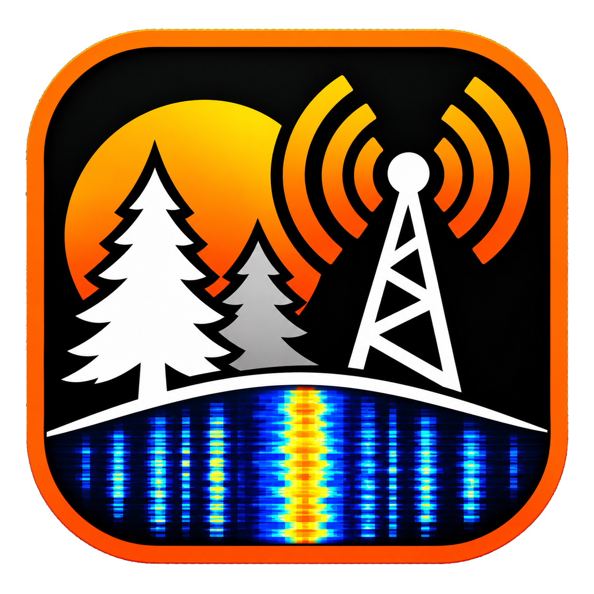

<p align="center"></p>

# POTA Auto-Digimationator for WSJT-X

POTA Auto-Digimationator watches WSJT-X decodes over UDP and calls POTA activators for you, the same way a double-click on a decode would. It is a native Windows program written in Rust (egui/eframe).

It was developed and tested using [WSJT-X Improved](https://ws-suite.sourceforge.io/). Stock WSJT-X is supported too.

**You stay the control operator.** Fully automated QSOs are prohibited. The program only helps you call stations: it asks you to confirm that you're at your station every time you turn an Auto mode on, and it checks that you're still there every 10 minutes (see [Safety](#safety)).

## Contents

- [Getting started](#getting-started)
- [The main window](#the-main-window)
- [How Auto-Hunt works](#how-auto-hunt-works)
- [Auto CQ/Answer](#auto-cqanswer)
- [Logging](#logging)
- [pota.app: spots and hunt counts](#potaapp-spots-and-hunt-counts)
- [Radio (CAT) settings](#radio-cat-settings)
- [Making it yours](#making-it-yours)
- [Safety](#safety)
- [Files](#files)
- [Building](#building)
- [License](#license)

## Getting started

### 1. Set up WSJT-X

The same instructions are in the app under **Settings > Connections > WSJT-X setup**, with a live connection indicator and the address and port it listens on.

- **Settings > Reporting**: UDP Server `224.0.0.2`, port `2237`, **Accept UDP requests** ticked.
- **Disable Tx after sending 73** on, so Tx stops at the end of each QSO.
- **Auto Seq** on.
- **Hold Tx Freq** ticked if you want Tx to stay where you put it (see [Move Tx](#move-tx)).
- In WSJT-X Improved, untick **CQ only** and **Hide FT8 dupes** in the Band Activity window. WSJT-X only acts on a call to a line it is showing, so a hidden line is ignored. If you keep CQ only on, switch off **Settings > Hunting > Call stations after their 73**.

### 2. Run the program

Build it (see [Building](#building)) and run `target\release\pota-auto-digimationator.exe`. The window shows "Waiting for WSJT-X..." until WSJT-X's first status message arrives.

### 3. First run

It opens with **Auto-Hunt Disabled** (red button) and **Dry run** on.

1. Click the button and confirm you're at your station. It turns green (**Auto-Hunt Enabled (Dry run)**) and logs what it *would* call, without transmitting.
2. When you're happy with what it picks, turn **Settings > Hunting > Dry run** off to let it transmit.

All options are in the **Settings** panel (gear button at the top right, or Ctrl+,). Every change is saved at once.

## The main window

From top to bottom: a header (app icon, title, the **Auto CQ/Answer** and **Auto-Hunt** buttons, theme and Settings buttons), a status row, then the sections.

**Status row**: WSJT-X connection, your station / band / frequency, band and mode drop-downs, a radio-state badge (TRANSMITTING, DECODING, RECEIVING, with a bar that follows WSJT-X's own period progress), who you're working, and the pota.app chip (spot counts and the time to the next refresh).

**Sections**

| Section | What it shows |
| --- | --- |
| **Current Info** | WSJT-X and rig state, and your pota.app account status |
| **Activity** | The log: candidates, calls, answers, skips. Has a search box and Clear. Lines carry buttons (Call now, Skip, Answer, Halt Tx) |
| **POTA Spots (New to me)** | Parks you've never hunted that are spotted on *other* bands and modes, each with a **QSY** button that retunes WSJT-X |
| **Current POTA Spots (Not worked today)** | Spots on the band and mode WSJT-X is on, newest first |
| **Current POTA Spots (Worked/Skipped today)** | Spots you've already worked (green **W**) or skipped (amber **S**) |
| **Worked today (date)** | Every QSO today (UTC), with a search box and a countdown to 0000Z |

Hover a column heading for what it means. Right-click a spot row to Skip or Unskip it. Click a call or park to open it on pota.app. You can select any text with the mouse and copy it with Ctrl+C.

**Changing band or mode**: use the drop-downs in the status row. They press WSJT-X's own band and mode buttons, and refuse while a QSO is in progress, Tx is on, an Auto mode is on or the Log QSO window is open.

## How Auto-Hunt works

### What it calls

A decode is a candidate when it's a `CQ …` or an `… RR73` / `… 73` (the sender is about to free up) **and** one of these is true:

- the message is `CQ POTA <call> …`
- the callsign has an active spot on pota.app **on the band WSJT-X is on now**

Turn on **Settings > Hunting > Only hunt new parks** to restrict this to stations whose spotted park you've never hunted (needs your [pota.app login](#potaapp-spots-and-hunt-counts)).

### What it skips

- **Weak stations.** Nothing weaker than **-20 dB** is auto-called (change it under **Settings > Hunting > Skip stations weaker than**, -24 to -6 dB or No limit). Skipped stations still show in the log, with the reason.
- **Stations already worked today (UTC)** on the same band and mode **at the same park**. If an activator moves to a new park the same day, it calls them again. When the park isn't known, either for the earlier QSO (WSJT-X's own log doesn't record parks) or for where they are now (not spotted), it doesn't call them again on that band and mode until 0000Z.
- **Stations you skipped.** Click **Skip** on a Candidate or CALLING line, or right-click the spot row and choose Skip. They won't be called again today on that band, mode and park, and Tx is halted if it was the station being called. Right-click a skipped spot to unskip it.

The worked list is loaded at startup from today's entries in WSJT-X's log (`wsjtx_log.adi`; WSJT-X and WSJT-X Improved keep theirs in different folders and the newest is used) and from the program's own `state.json`. That file remembers the parks it confirmed, QSOs that finished on air but weren't logged, and your skips. It's cleared at 0000Z.

### How it picks and calls

- When several candidates decode in the same cycle, it calls the one with the **strongest SNR**. If nothing is worth calling, the log shows one grey line such as `38 calls decoded, no needed POTA`.
- It **never calls while WSJT-X has Tx enabled**, so it won't interrupt a QSO or your own CQ. A QSO in progress is never overridden.
- You can always call a candidate yourself with its **Call now** button, even with Auto-Hunt disabled or in Dry run.
- Each call is sent as a Reply, exactly as a double-click on the decode line would.

### Move Tx

By default only Rx moves to the station you call; with Hold Tx Freq ticked in WSJT-X, Tx stays wherever you put it. Turn on **Settings > Hunting > Move Tx to their frequency** to send each call as a Ctrl+double-click instead, which puts Tx exactly on the station. WSJT-X's UDP interface can't set Tx to an offset such as 50 Hz away.

### When they don't answer

- After the set number of unanswered calls (**Settings > Hunting > Give up after**, per mode: FT8 5, FT4 10, FT2 20), it halts Tx and leaves that station alone for 10 minutes.
- If that station calls you during those 10 minutes (a late answer out of a pileup), it replies straight away and the QSO carries on, unless WSJT-X is busy with another QSO.
- If the station sends a fresh CQ or 73 while you're waiting on it or have given up on it, the call count restarts.
- **Halt Tx** and **Skip** buttons appear, glowing, on the line of the QSO in progress.

### When a station calls you

If a station calls you and the program isn't going to answer, for example because you never called them, the log says so and puts an **Answer** button at the start of the line. Clicking it replies exactly as a double-click in WSJT-X would, even while Auto-Hunt is disabled or in Dry run, and the QSO is then handled like an auto-call. The button works for 5 minutes. A 73 or RR73 sent to you just shows as "sent you 73", with no button.

## Auto CQ/Answer

A second button, left of Auto-Hunt, keeps your station calling CQ and answers the stations that call you. It starts disabled, shares Dry run, and asks for the same confirmation.

- Pick the CQ text (CQ, CQ POTA or CQ DX) under **Settings > Hunting**. It is sent as `<text> <your call> <grid>` through WSJT-X's own Tx6 box and Enable Tx button, so WSJT-X repeats it each period.
- Callers are answered strongest first. If WSJT-X's Auto Seq answers one first, the program adopts that QSO and tracks it.
- **Auto-Hunt has priority**: a hunt candidate is called over your idle CQ. A QSO in progress is never interrupted.
- Your Tx frequency never moves while this mode is on.
- Pressing **Halt Tx** in WSJT-X switches the mode off. Turning it off halts the CQ unless a QSO is in progress.

## Logging

WSJT-X pops up its Log QSO window after each QSO and only logs it (and tells this program) once OK is clicked. There's no UDP command for that, so:

- When a QSO finishes (RR73 / RRR / 73 exchanged), the station is marked worked straight away. It won't be called again on that band and mode even if the QSO never gets logged. The worked list shows a red cross in the Log column until WSJT-X logs it.
- With **Settings > Logging > Press OK on WSJT-X's Log QSO window** on (the default), the program presses OK whenever that window opens, for any QSO. It sends Enter to the window directly, so it doesn't steal focus. If the window doesn't close after a few tries, the log says so and you can click it yourself. This works whether Auto-Hunt is enabled or disabled.
- A sound plays whenever WSJT-X logs a QSO (**Settings > Logging**: on or off, test it, or choose your own file).

### ACLog

With **Settings > Logging > ACLog** on, each QSO WSJT-X logs is also sent to N3FJP ACLog through its TCP API. In ACLog, turn on Settings > Application Program Interface > TCP API (default port 1100), then set the host and port with **Edit** on the Logging page. The park reference goes into ACLog's `Other` field titled `SIG_INFO` (found automatically) and into the comments as `POTA <ref> <park name>`.

If ACLog already gets QSOs straight from WSJT-X (ACLog's own WSJT-X link or JTAlert), leave this off. ACLog's duplicate check only catches a double entry when the call, date, time on, band, mode and grids all match.

## pota.app: spots and hunt counts

**Spots** are fetched **once a minute at most** by one background thread and kept in a local copy (`spots_cache.json`); every check reads only that copy. If a fetch fails, the last copy is kept and it retries after 10 seconds, then 30 seconds, then every minute.

**Hunt counts (optional).** Enter your pota.app username and password under **Settings > Connections > pota.app account** and the lists show how often you've hunted each station and park:

- a count in parentheses after a call you've worked before
- in front of the park, an orange **NEW** chip if you've never hunted it (a purple **ATNO** when the park has never had a qualifying activation), or the count in parentheses if you have

The counts come from your pota.app account and refresh every 30 minutes, so today's QSOs appear after you upload your log. The password is stored in plain text in `settings.json` on this computer and sent only to pota.app's sign-in service.

## Radio (CAT) settings

**Settings > Radio** can keep attenuator, noise blanker and noise reduction off on a Yaesu FTDX101D, by passing CAT commands through ACLog's API. This is **on by default**: it is sent at start-up and after each band or mode change. If you don't use that rig or ACLog, switch it off. On close the program can put each setting back on, off or leave it alone (the radio can't be read back, so it can't restore what it found).

## Making it yours

- **Theme**: Match Windows (default), Light or Dark, under **Settings > Appearance** or with the sun/moon button.
- **Font size**: **Settings > Appearance > Text size**, with − and + buttons. It changes the whole window at once.
- **Pop-out**: the button at the right end of each section's header moves that section into its own window. Drag it to another monitor if you like. Click the button again (or close the window) to put it back.
- **Rearrange**: drag a section's header to move it above or below another section, in either column. Drag the dividers to resize.
- Window position and size, section order, sizes and pop-out windows are all remembered.

## Safety

- It starts with Auto-Hunt disabled and Dry run on.
- Turning Auto-Hunt or Auto CQ/Answer on always asks you to confirm that you're at your station, even in Dry run.
- While either is on, it asks **"Are you still there?"** every 10 minutes (any click or key press in the program restarts that clock). If you don't answer within a minute, both modes switch off. A QSO already in progress is left alone.

## Files

`settings.json`, `state.json` and `spots_cache.json` live in a `data` folder in the exe's folder (a build inside `target\release` of the source tree uses the project root instead). The QSO-logged sound and the icon are built into the exe, so it runs on its own.

## Building

Install Rust (https://rustup.rs) and the Windows SDK (for the icon resource), then:

```
cargo build --release
```

Run `target\release\pota-auto-digimationator.exe`. Tests: `cargo test`.

Pushing a version tag (`vX.Y.Z`) makes GitHub Actions build and publish the exe as a release.

## License

Copyright (c) 2026 Dan Muntz (WD4DAN)

This program is free software: you can redistribute it and/or modify it under the terms of the GNU General Public License as published by the Free Software Foundation, either version 3 of the License, or (at your option) any later version. It is distributed in the hope that it will be useful, but WITHOUT ANY WARRANTY; without even the implied warranty of MERCHANTABILITY or FITNESS FOR A PARTICULAR PURPOSE. See the [LICENSE](LICENSE) file for the full text.
